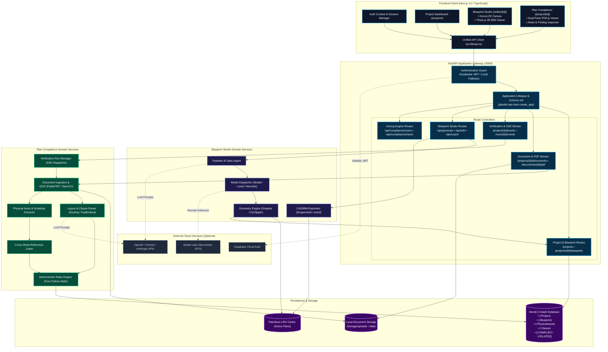
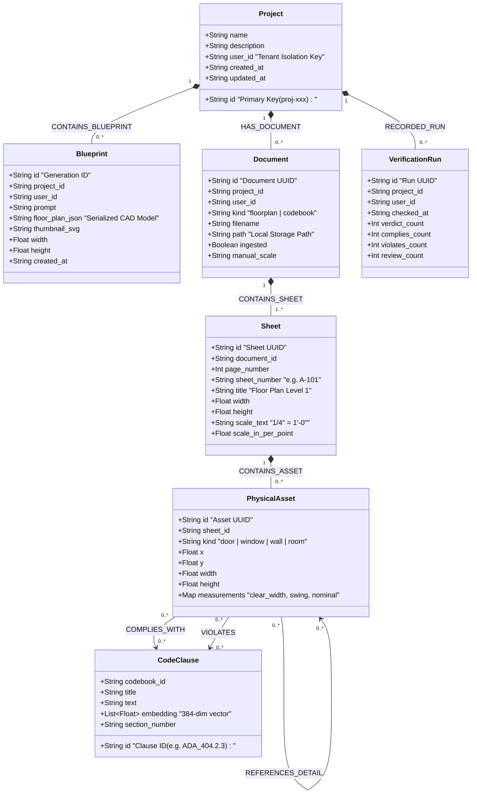
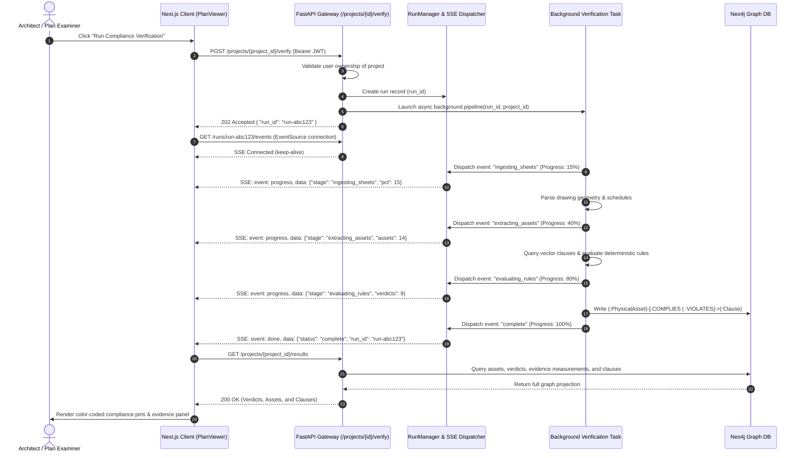

# BuildWise v2 — System Architecture & Technical Specifications

> **Audience**: Platform maintainers, AEC systems engineers, software architects, and technical contributors.  
> **Repository**: [https://github.com/inddivyansh/BuildWise_v2](https://github.com/inddivyansh/BuildWise_v2)  
> **Release**: v2.4.0 (Unified AEC Platform)

---

## 📑 Table of Contents
1. [Architectural Mission & Design Principles](#1-architectural-mission--design-principles)
2. [High-Level System Topology](#2-high-level-system-topology)
3. [Diagram A — Component & System Architecture](#3-diagram-a--component--system-architecture)
4. [Diagram B — Dual-Workflow Operational Flow](#4-diagram-b--dual-workflow-operational-flow)
5. [Diagram C — Knowledge Graph & Data Schema](#5-diagram-c--knowledge-graph--data-schema)
6. [Diagram D — Asynchronous Verification & SSE Sequence](#6-diagram-d--asynchronous-verification--sse-sequence)
7. [Frontend Architecture & State Management](#7-frontend-architecture--state-management)
8. [Backend Architecture & Routing Catalog](#8-backend-architecture--routing-catalog)
9. [Blueprint Studio: Generative Pipeline & CAD Engine](#9-blueprint-studio-generative-pipeline--cad-engine)
10. [Plan Compliance: Ingestion & Deterministic Verification](#10-plan-compliance-ingestion--deterministic-verification)
11. [Cross-Workflow Handoff Bridge](#11-cross-workflow-handoff-bridge)
12. [Multi-Tenant Isolation & Authentication Boundary](#12-multi-tenant-isolation--authentication-boundary)
13. [Implementation Status Matrix](#13-implementation-status-matrix)
14. [Deployment Boundaries, Scaling & Failure Modes](#14-deployment-boundaries-scaling--failure-modes)

---

## 1. Architectural Mission & Design Principles

BuildWise v2 is engineered as a unified, dual-engine AEC (Architecture, Engineering, and Construction) platform that solves two complementary challenges in the built environment:

1. **Generative Ideation (Blueprint Studio)**: Rapid synthesis of preliminary architectural floor plans from unstructured natural language client requirements and parametric design briefs.
2. **Deterministic Verification (Plan Compliance)**: Mathematical, evidence-grounded verification of architectural drawings against statutory municipal building codes and accessibility guidelines.

### Core Architectural Principles

* **The Zero-Guesswork Rule for Compliance**: Large Language Models (LLMs) are strictly confined to unstructured document parsing, text OCR correction, and intent translation. **No LLM ever determines compliance.** Every pass/fail verdict is computed by deterministic Python functions evaluating spatial measurements (clear width, turning radii, setbacks) against extracted numerical thresholds.
* **Grounding & Traceability**: Every compliance finding in BuildWise v2 is linked to physical geometric assets on the drawing sheet (doors, walls, corridors), tabular schedules, and specific legal clauses in municipal codebooks.
* **Separation of Concerns**: Generative workflows produce soft, editable layout drafts; compliance workflows produce immutable, auditable proof graphs.
* **Tenant Isolation by Default**: User assets, projects, drawings, and blueprints are strictly scoped to authenticated user IDs in both graph queries and local file storage.
* **Progressive Enhancement & Offline Readiness**: The platform operates with zero API keys or external GPU services by automatically utilizing built-in deterministic heuristic generators and offline extraction rules.

---

## 2. High-Level System Topology

The BuildWise v2 platform is divided into five cohesive tiers:

1. **Presentation Tier (Next.js 14 SPA/SSR)**: React 18, HTML5 Canvas/Konva 2D vector editor, Three.js/React Three Fiber 3D BIM spatial viewer, PDF.js dual-pane inspection viewer, and Zustand reactive stores.
2. **Gateway & API Tier (FastAPI Unified ASGI)**: Dual-mounted REST endpoints (`/projects`, `/api/*`), Server-Sent Events (SSE) streaming engine, Supabase JWT verification middleware, and CORS handling.
3. **Domain Engine Tier**:
   - *Blueprint Studio Engine*: Pydantic AI structured specification generator, HouseDiffusion/GS-Diff ML models, heuristic generator, Shapely geometry normalizer, and PyClipper polygon offset engine.
   - *Plan Compliance Engine*: Multi-page drawing indexer, Docling layout-aware codebook parser, FastEmbed vector retriever, schedule table extractor, cross-sheet callout resolver, and deterministic rule evaluator.
4. **Persistence & Cache Tier**:
   - *Neo4j 5 Graph Database*: Primary store for projects, durable blueprints, physical assets, building code clauses, cross-sheet references, and immutable verdict relationships.
   - *Local File Storage*: Uploaded architectural drawing sets, PDF codebooks, and temporary raster artifacts.
   - *In-Memory LRU Plan Store*: Session-scoped cache for active editing and immediate CAD export.
5. **External & Cloud Integrations (Optional)**:
   - *Supabase Auth*: Multi-tenant user authentication and session management.
   - *Modal Labs*: Serverless remote GPU execution for heavy diffusion checkpoints.
   - *LLM Providers*: Google Gemini, OpenAI, or Anthropic for semantic clause extraction.

---

## 3. Diagram A — Component & System Architecture



---

## 4. Diagram B — Dual-Workflow Operational Flow

```mermaid
flowchart TD
  %% Style Classes
  classDef startNode fill:#0284c7,stroke:#38bdf8,stroke-width:2px,color:#ffffff;
  classDef studioNode fill:#1e1b4b,stroke:#818cf8,stroke-width:2px,color:#f8fafc;
  classDef auditNode fill:#064e3b,stroke:#10b981,stroke-width:2px,color:#f8fafc;
  classDef bridgeNode fill:#7c2d12,stroke:#f97316,stroke-width:2px,color:#f8fafc;
  classDef endNode fill:#14532d,stroke:#22c55e,stroke-width:2px,color:#ffffff;

  subgraph WorkflowA ["Workflow 1: Generative Blueprint Studio (Ideation & Drafting)"]
    StartA(["Client Brief / Natural Language Prompt"]):::startNode
    ParseSpec["1. Synthesize Structured FloorPlanSpec<br/>(Pydantic AI / Room Program)"]:::studioNode
    GeneratePlan["2. Generate Spatial Layout<br/>(Diffusion / Local Heuristic Engine)"]:::studioNode
    NormalizeGeo["3. Clean Geometry & Resolve Adjacencies<br/>(Shapely Union / Walls / Door Swings)"]:::studioNode
    ZoningEval["4. Check Municipal Zoning Constraints<br/>(Setbacks / Lot Coverage / Height)"]:::studioNode
    InteractiveEdit["5. Interactive 2D Konva & 3D Three.js Studio<br/>• Drag rooms, adjust walls<br/>• Conversational editing prompts"]:::studioNode
    SaveBlueprint["6. Save Durable Blueprint to Project History<br/>(POST /projects/{id}/blueprints)"]:::studioNode
    ExportCAD["7. Export Production Files<br/>(IFC 4.0 BIM • AutoCAD DXF • SVG)"]:::endNode
  end

  subgraph WorkflowBridge ["Cross-Workflow Handoff Bridge"]
    ConvertSheet["Convert Blueprint to Architectural Vector Drawing<br/>• Architectural title block<br/>• Scale notation (1:100 / 1:50)<br/>• Dimension lines & door schedule"]:::bridgeNode
    PushAudit["Submit to Project Compliance Pipeline<br/>(POST /projects/{id}/documents?kind=floorplan)"]:::bridgeNode
  end

  subgraph WorkflowB ["Workflow 2: Plan Compliance (Deterministic Code Verification)"]
    StartB(["Upload Architectural Drawing Set & Municipal Codebooks"]):::startNode
    DocIngestion["1. Ingest Multi-Page PDF Drawing & Codebook<br/>• Detect vector paths vs scanned rasters<br/>• Calculate drawing scale (in/pt)"]:::auditNode
    ExtractGeometry["2. Geometric Extraction<br/>• Identify physical assets (doors, walls, stairs)<br/>• Detect & parse tabular door/window schedules"]:::auditNode
    ExtractClauses["3. Parse Codebook Regulations<br/>• Layout-aware parsing (Docling)<br/>• FastEmbed vector indexing of clauses"]:::auditNode
    ResolveRefs["4. Resolve Cross-Sheet Callouts<br/>• Link detail callouts (e.g. 1/A3.0) across multi-page PDF"]:::auditNode
    EvaluateRules["5. Pure-Python Deterministic Evaluation<br/>• Clear width vs ADA 404.2.3 (min 32\")<br/>• Corridor width vs IBC 1005 (min 44\")<br/>• Door swing clearances"]:::auditNode
    WriteGraph["6. Commit Immutable Audit Graph<br/>(:PhysicalAsset)-[:COMPLIES / :VIOLATES]->(:Clause)"]:::auditNode
    InspectResults["7. Dual-Pane Interactive Visual Inspection<br/>• Click red violation pin on drawing<br/>• Right pane auto-scrolls to governing law"]:::endNode
  end

  %% Flow inside Workflow A
  StartA --> ParseSpec --> GeneratePlan --> NormalizeGeo --> ZoningEval --> InteractiveEdit
  InteractiveEdit --> SaveBlueprint
  InteractiveEdit --> ExportCAD

  %% Handoff Bridge Connection
  InteractiveEdit -.->|"1-Click 'Send to Compliance Audit'"| ConvertSheet
  ConvertSheet --> PushAudit
  PushAudit --> DocIngestion

  %% Flow inside Workflow B
  StartB --> DocIngestion
  DocIngestion --> ExtractGeometry & ExtractClauses
  ExtractGeometry --> ResolveRefs
  ExtractClauses & ResolveRefs --> EvaluateRules
  EvaluateRules --> WriteGraph --> InspectResults
```

---

## 5. Diagram C — Knowledge Graph & Data Schema

The Neo4j database serves as the source of truth for project ownership, durable blueprints, extracted physical building assets, parsed building codes, and compliance verdicts:



---

## 6. Diagram D — Asynchronous Verification & SSE Sequence

Due to the computational complexity of parsing multi-megabyte PDF drawings, OCR layout analysis, and geometric rule checks, the Plan Compliance verification pipeline executes asynchronously with real-time Server-Sent Events (SSE):



---

## 7. Frontend Architecture & State Management

The frontend is built with Next.js 14 utilizing the App Router architecture, TypeScript, and Tailwind CSS:

### Application Routes
- `/projects`: Main workspace dashboard displaying all owned projects, document counts, blueprint counts, and recent compliance statuses.
- `/project/[id]`: Plan Compliance audit workspace featuring the dual-pane vector `PlanViewer`, `AssetInspector`, `CodePane`, and `RunProgress` tracker.
- `/editor/[id]` *(and `/editor`)*: Blueprint Studio featuring the interactive 2D `FloorPlanCanvas`, 3D `ThreeViewer`, `Toolbar`, `PropertyPanel`, `NLInput`, and `ExportMenu`.
- `/login` & `/signup`: User authentication interfaces connected to Supabase Auth.

### State Management Stores (`frontend/src/stores/`)
- `floorPlanStore.ts`: Primary reactive store for Blueprint Studio holding the active `GeneratedFloorPlan` model (walls, rooms, doors, windows, plot dimensions), active tool (`select`, `wall`, `room`, `door`, `window`), zoom scale, and undo/redo stacks.
- `editorStore.ts`: Manages UI state, active viewport mode (`2D` vector vs `3D` BIM walkthrough), selected asset IDs, grid snapping parameters, and dialog visibility.
- `modelStore.ts`: Persistent store backed by `localStorage` tracking the active AI provider (`gemini`, `groq`, `xai`, `ollama`) and model selection (`gemini-2.5-flash`, `qwen-2.5-32b`, etc.) across generation dialogs, canvas overlays, and editor sessions.
- `AuthContext.tsx`: React context managing the active authenticated session, user profile, and automatic Bearer token injection for HTTP requests.

### Key Visual Components
- `ModelSelector.tsx` (`src/components/editor/`): Dual-group model picker featuring:
  - **Free-Tier Models**: Live indicators showing provider configuration status (`Configured` vs `Key Required`), free tier quotas, and capability tags.
  - **Premium Models (Coming Soon)**: Disabled, non-selectable OpenAI and Anthropic models clearly labeled for future enterprise releases.
- `FloorPlanCanvas.tsx` (`src/components/canvas/`): HTML5 Canvas vector renderer powered by Konva. Handles real-time drag-and-drop spatial manipulation, bounding-box handles, alignment snapping, and dimension arrows.
- `ThreeViewer.tsx` (`src/components/viewer/`): WebGL 3D modeler using Three.js and React Three Fiber. Generates volumetric polygon extrusions for exterior/interior walls with cutouts for door openings and translucent window panes.
- `PlanViewer.tsx` (`src/components/`): Vector architectural drawing inspector powered by PDF.js with SVG overlays. Renders color-coded bounding boxes over audited physical assets (green = pass, red = violation, amber = review required).

---

## 8. Backend Architecture & Routing Catalog

The backend is built with FastAPI 0.115+ and Python 3.10+, orchestrated through a unified application factory in `planlint/api/main.py`:

### Application Factory & Lifespan
```python
def create_app(repo=None, embedder=None) -> FastAPI:
    # Lifespan initializes the Neo4j AsyncGraphDatabase driver, executes
    # schema indexing, and loads FastEmbed vector embedding models.
```

### Route Implementations
1. **Plan Compliance & Projects (`planlint/api/routes.py`)**:
   - `GET /projects`: List user-owned projects with document and blueprint metrics.
   - `POST /projects`: Create a new project workspace.
   - `GET /projects/{id}`: Fetch project details and latest verification summary.
   - `DELETE /projects/{id}`: Delete a project, all associated graph nodes, and files.
   - `POST /projects/{id}/documents`: Upload a floor-plan drawing or codebook PDF.
   - `GET /documents/{id}/pdf`: Stream original PDF for vector canvas inspection.
   - `PATCH /documents/{id}/scale`: Set manual drawing scale override.
   - `POST /projects/{id}/verify`: Initiate asynchronous compliance verification pipeline.
   - `GET /runs/{id}/events`: SSE stream of pipeline progress.
   - `GET /projects/{id}/results`: Retrieve final verdicts, evidence, and code clauses.
2. **Project Blueprint History (`planlint/api/blueprints.py`)**:
   - `GET /projects/{id}/blueprints`: List all durable blueprints saved to a project.
   - `GET /projects/{id}/blueprints/{bp_id}`: Fetch full CAD model of a saved blueprint.
   - `DELETE /projects/{id}/blueprints/{bp_id}`: Remove a blueprint from project history.
3. **AI Models & Provider Catalog (`app/api/routes/models.py`)**:
   - `GET /api/models`: Return available model catalog, active configuration status per provider, free-tier allowlist, and default model ID.
4. **Blueprint Studio Generation (`app/api/routes/generate.py`)**:
   - `POST /api/generate`: Generate complete floor plan from text prompt (`prompt`, optional `model`, `provider`).
   - `POST /api/generate/from-spec`: Generate floor plan from structured `FloorPlanSpec`.
5. **Blueprint Studio Editing (`app/api/routes/edit.py`)**:
   - `POST /api/edit`: Apply parametric or natural language edits to an active plan (`prompt`, `generation_id`, optional `model`).
6. **CAD/BIM Exports (`app/api/routes/export.py`)**:
   - `GET /api/export/formats`: List supported export formats (`svg`, `dxf`).
   - `GET /api/export/{id}/{fmt}`: Stream requested CAD file.
7. **Zoning Engine (`app/api/routes/compliance.py`)**:
   - `GET /api/compliance/zones`: List available municipal zoning presets.
   - `POST /api/compliance/check`: Perform design-time setback and lot coverage checks.

---

## 9. Blueprint Studio: Generative Pipeline & CAD Engine

Blueprint Studio transforms natural language or structured specifications into production-grade CAD geometry:

1. **Multi-Provider AI Architecture (`app/services/llm/`)**:
   - `providers.py`: Central model catalog, capability registry, and strict allowlist enforcement:
     - **Free-Tier Allowlist (`FREE_TIER_ALLOWLIST`)**: Only verified free-tier models (`gemini-2.5-flash`, `gemini-1.5-flash`, `qwen-2.5-32b`, `grok-beta`, `ollama:qwen2.5`) can be invoked.
     - **Premium Guardrails (`PREMIUM_MODEL_IDS`)**: Requests requesting commercial models (`gpt-4o`, `claude-3-5-sonnet`) are safely intercepted and rejected with a descriptive `Coming Soon` error.
     - **Provider Introspection (`is_provider_configured`)**: Inspects runtime environment without exposing sensitive tokens to browser clients.
   - `client.py`: Multi-provider LLM client implementing OpenAI-compatible schema dispatching to Google Gemini, Groq, xAI, or local Ollama endpoints. Includes sanitized exception handling that strips API keys from logs and client-facing error payloads.
2. **Prompt to Program Synthesis**:
   - Uses Pydantic AI with typed schemas (`FloorPlanSpec`) to parse room types, quantities, minimum dimensions, and adjacency constraints.
3. **Generative Model Dispatcher (`app/services/generation/dispatcher.py`)**:
   - *Remote GPU*: Dispatches to Modal Labs serverless GPU running HouseDiffusion or GS-Diff checkpoints when configured.
   - *Local GPU/CPU*: Loads PyTorch weights if available locally.
   - *Heuristic Fallback Engine (`mock.py`)*: When no ML checkpoints or API keys are present, a deterministic spatial packing heuristic generates fully compliant, vector-accurate layouts with living/dining rooms, primary bedrooms, kitchens, and ADA-compliant restrooms. Zero silent fallbacks to paid APIs.
4. **Computational Geometry Normalization (`app/services/geometry/`)**:
   - `operations.py`: Uses Shapely 2.0 to perform polygon intersection, clipping, and coordinate rounding.
   - `adjacency.py`: Analyzes shared wall boundaries to position interior doors and passage openings.
   - `cleanup.py`: Uses PyClipper to resolve self-intersecting polygons and eliminate micro-gaps.
5. **CAD/BIM File Exporters (`app/services/export/`)**:
   - `ifc_builder.py`: Constructs native `IfcProject`, `IfcSite`, `IfcBuilding`, `IfcBuildingStorey`, `IfcWallStandardCase`, `IfcDoor`, and `IfcWindow` entities via `ifcopenshell`.
   - `dxf_exporter.py`: Generates standardized AutoCAD DXF drawings with dedicated layers for walls, door swing arcs, window openings, and dimension strings via `ezdxf`.

---

## 10. Plan Compliance: Ingestion & Deterministic Verification

The Plan Compliance engine audits uploaded drawing sheets against building codes:

1. **Document Ingestion (`planlint/ingest/`)**:
   - `sheet_index.py`: Identifies sheet numbers, titles, and scale indicators from drawing title blocks.
   - `scale_detection.py`: Analyzes scale text strings (e.g., `1/4" = 1'-0"` or `1:100`), calculating the exact mathematical scale factor in inches per point.
2. **Physical Asset & Schedule Extraction**:
   - `vector_geometry.py` & `raster_geometry.py`: Extracts vector line primitives representing walls and door arcs.
   - `schedule.py`: Detects tabular door and window schedules on the sheet, extracting nominal sizes, fire ratings, and clear dimensions.
3. **Semantic Codebook Ingestion (`planlint/ingest/semantic.py`)**:
   - Ingests municipal codebooks (e.g., ADA Standards, IBC Chapter 10 Egress).
   - Uses Docling for layout-aware table and hierarchy extraction.
   - Chunks regulations into atomic legal clauses and generates 384-dimensional dense vector embeddings using `fastembed` (`BAAI/bge-small-en-v1.5`).
4. **Deterministic Rule Evaluator (`planlint/verify/checker.py`)**:
   - Pure-Python geometric algorithms check measurements against regulations:
     - **ADA Section 404.2.3 (Clear Door Width)**: Asserts that measured door clear width $\ge 32.0\text{ inches}$.
     - **IBC Section 1005 (Egress Width)**: Asserts that corridor width $\ge 44.0\text{ inches}$.
     - **ADA Section 404.2.4 (Maneuvering Clearance)**: Evaluates door approach clearances.
5. **Graph Verdict Persistence**:
   - Creates `:COMPLIES_WITH` or `:VIOLATES` edges in Neo4j with measured values, required thresholds, and discrepancy deltas.

---

## 11. Cross-Workflow Handoff Bridge

BuildWise v2 provides a seamless 1-click bridge between the generative studio and compliance audit workflows:

1. **Client-Side Trigger**: Within Blueprint Studio (`/editor/[id]`), clicking the **"Send to Compliance Audit"** action converts the active `GeneratedFloorPlan` into a vector architectural drawing PDF using `pdfExport.ts`.
2. **Architectural Sheet Synthesis**: The exporter injects an industry-standard architectural title block, drawing scale notation (`1:100`), room dimension strings, and door schedule tables directly onto the canvas.
3. **Project Ingestion**: The synthesized PDF is posted directly to `POST /projects/{id}/documents?kind=floorplan`, automatically registering the blueprint in the compliance workspace for immediate audit.

---

## 12. Multi-Tenant Isolation & Authentication Boundary

Security and data isolation are enforced across all layers:

1. **Authentication Guard (`planlint/api/auth.py`)**:
   - Inspects incoming `Authorization: Bearer <token>` headers.
   - When configured, validates the JWT against `SUPABASE_JWT_SECRET` and extracts the authenticated user ID (`user.id`).
   - When `AUTH_REQUIRED=false` (in local development), falls back to a deterministic developer user ID (`00000000-0000-0000-0000-000000000001`).
2. **Database Isolation (`planlint/graph/repository.py`)**:
   - Every Cypher query enforces tenant ownership:
     ```cypher
     MATCH (p:Project {id: $project_id, user_id: $user_id})
     ```
   - Cross-tenant access attempts return `HTTP 404 Not Found` to prevent project enumeration.
3. **Storage Isolation**:
   - Uploaded drawings and generated files are stored in user-scoped subdirectories within `/storage/uploads/{user_id}/`.

---

## 13. Implementation Status Matrix

| Component / Subsystem | Implementation Status | Operational Mode | Notes |
|---|:---:|:---:|---|
| **Blueprint Studio 2D Canvas** | Implemented | Available | HTML5 Canvas / Konva vector rendering |
| **Blueprint Studio 3D Viewer** | Implemented | Available | WebGL / Three.js / React Three Fiber |
| **Heuristic Blueprint Generator** | Implemented | Available | Built-in zero-dependency spatial packing |
| **Pydantic AI Spec Generator** | Implemented | Requires LLM Key | Gemini / OpenAI / Anthropic integration |
| **HouseDiffusion ML Engine** | Implemented | Requires GPU / Modal | Serverless remote GPU inference via Modal |
| **CAD / BIM Exporters (IFC, DXF)** | Implemented | Available | Native `ifcopenshell` and `ezdxf` generation |
| **Vector PDF Ingestion & Stream** | Implemented | Available | PyMuPDF streaming & PDF.js viewer |
| **Schedule Table Grounding** | Implemented | Available | Tabular regex and layout grounding |
| **Cross-Sheet Callout Resolver** | Implemented | Available | Multi-page drawing graph linker |
| **Deterministic Rule Engine** | Implemented | Available | Pure-Python geometric verification |
| **Neo4j Graph Persistence** | Implemented | Available | Multi-tenant schema and audit edges |
| **Supabase Multi-Tenant Auth** | Implemented | Available (+ Fallback) | Full JWT verification + local dev fallback |
| **Multi-Story Vertical Core Solver**| Future Roadmap | Planned for v2.5 | Structural shaft & stair coordination |

---

## 14. Deployment Boundaries, Scaling & Failure Modes

### Docker Services Boundary
- `frontend`: Next.js 14 standalone Node.js container exposing port `3000`.
- `backend`: FastAPI Python 3.11 container exposing port `8000`, mounting `/app/storage` and `/app/data`.
- `neo4j`: Neo4j 5 Community container exposing ports `7474` (browser) and `7687` (Bolt), mounting `neo4j_data`.

### Failure Handling & Resilience
- **Neo4j Disconnection**: The backend health check (`/api/health`) reports degraded status if the Bolt connection fails. In-memory LRU caching prevents session data loss during brief database restarts.
- **LLM Rate Limits & Outages**: If an external LLM call fails during specification generation, the platform falls back to the deterministic heuristic generator, ensuring the user can always produce a valid, editable floor plan.
- **Large Document Processing**: Docling chunking settings (`PLANLINT_DOCLING_PAGE_CHUNK=2`) constrain peak memory usage to prevent Out-Of-Memory (OOM) crashes on large architectural drawing sets.
