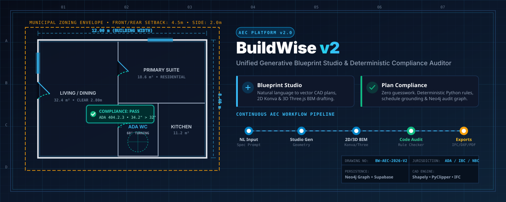
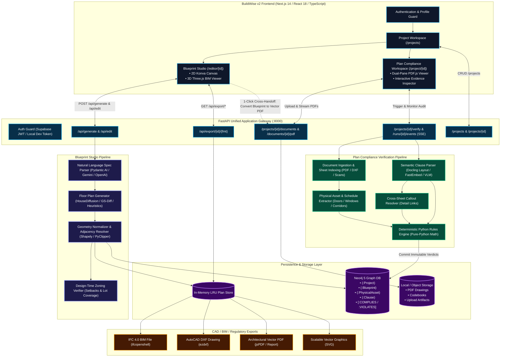
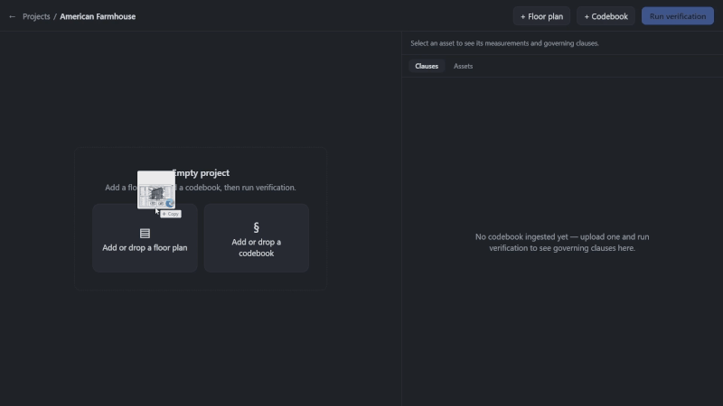

<p align="center">
  <a href="#readme">
    
  </a>
</p>

<p align="center">
  <strong>Next-Generation AEC Platform: Generative Architectural Blueprint Studio &amp; Deterministic Building Code Compliance Verification</strong>
</p>

<p align="center">
  
  
  
  
  
  
  
  
</p>

---

## 📑 Table of Contents
- [Executive Overview](#-executive-overview)
- [Target Audiences & Concrete Use Cases](#-target-audiences--concrete-use-cases)
- [Core Feature Suites](#-core-feature-suites)
  - [1. Blueprint Studio (Generative CAD & 3D BIM)](#1-blueprint-studio-generative-cad--3d-bim)
  - [2. Plan Compliance (Deterministic Code Auditor)](#2-plan-compliance-deterministic-code-auditor)
  - [3. Zoning & Design-Time Checks](#3-zoning--design-time-checks)
  - [4. Project Workspace & Tenant Isolation](#4-project-workspace--tenant-isolation)
  - [5. Cross-Workflow Handoff](#5-cross-workflow-handoff)
- [Platform Architecture & Workflow Diagram](#-platform-architecture--workflow-diagram)
- [Live Interactive Inspection Demo](#-live-interactive-inspection-demo)
- [System Capabilities & File Ingestion](#-system-capabilities--file-ingestion)
- [Technology Stack](#-technology-stack)
- [Quick-Start Guide](#-quick-start-guide)
  - [Prerequisites](#prerequisites)
  - [Local Development Setup](#local-development-setup)
  - [Docker Compose Deployment](#docker-compose-deployment)
- [Environment Configuration](#-environment-configuration)
- [API Reference & Route Catalog](#-api-reference--route-catalog)
- [Verification & Automated Test Suites](#-verification--automated-test-suites)
- [Security, Limitations & Legal Disclaimer](#-security-limitations--legal-disclaimer)
- [License & Authors](#-license--authors)

---

## 🧭 Executive Overview

**BuildWise v2** is a unified, open-source AEC (Architecture, Engineering, and Construction) software platform engineered to eliminate the gap between **generative architectural design** and **provable building code compliance**.

Modern building design and permitting are bottlenecked by fragmented workflows: architects draft conceptual layouts with iterative CAD tools, while compliance verification is performed through manual, error-prone human review against thousands of pages of municipal codebooks (ADA, IBC, local zoning bylaws). This friction produces multi-month permitting backlogs, costly field revisions, and delayed housing projects.

BuildWise v2 bridges this divide through an integrated, professional engineering suite:
1. **Generative Blueprint Drafting**: Turn customer requirements and programmatic briefs into vector-accurate floor plans complete with structural double-line walls, standardized door swings, window penetrations, and lot boundary setbacks.
2. **Interactive 2D & 3D BIM Studio**: Freely inspect, refine, and edit layouts through an interactive 2D vector canvas (Konva) and real-time 3D walkthrough viewer (Three.js).
3. **Deterministic Compliance Verification**: Audit uploaded drawings and municipal codebooks with **zero LLM guesswork**. A pure-Python geometric rules engine inspects grounded physical measurements against statutory requirements, recording immutable citation edges in a Neo4j knowledge graph.
4. **Instant 1-Click Cross Handoff**: Export generated blueprints into vector drawing sets with title blocks and dimension grids, immediately submitting them to the compliance audit engine.
5. **Open Industry CAD/BIM Exports**: Export production-ready files in **IFC (Industry Foundation Classes)**, **DXF (AutoCAD)**, **Vector PDF**, **SVG**, and **GeoJSON**.

---

## 🎯 Target Audiences & Concrete Use Cases

BuildWise v2 is tailored for AEC professionals, municipal regulators, and builders who require precision, repeatability, and transparency:

### 🏛️ 1. Government Housing Commissions & Municipal Planning Authorities
* **The Challenge**: Planning departments are inundated with thousands of permit applications each month. Plan examiners spend 60–70% of their review time manually measuring door clearances, corridor widths, and zoning setbacks.
* **BuildWise Solution**: Automated pre-screening of permit submittals. Municipal authorities can ingest contractor drawing sets and local bylaws, generating instant, color-coded compliance scorecards. Plan examiners receive exact clause citations (e.g. *ADA Section 404.2.3 Clear Width*) and side-by-side visual measurement overlays, accelerating review timelines from months to days.

### 🏗️ 2. General Contractors & Real Estate Developers
* **The Challenge**: Submitting drawings with overlooked code violations triggers formal plan check rejections, delaying groundbreaking by 8 to 16 weeks and incurring costly financing and remobilization expenses.
* **BuildWise Solution**: Pre-submission audit gate. Contractors run design-development drawings through BuildWise v2 prior to municipal filing. Potential violations (e.g., inadequate turning radius in accessible restrooms, undersized egress corridors, or lot coverage exceedances) are flagged immediately with recommended corrective dimensions.

### 📐 3. Architects & AEC Design Consultants
* **The Challenge**: Creating custom schematic floor plans for client consultations requires hours of manual drafting in AutoCAD or Revit before client preferences are even finalized.
* **BuildWise Solution**: Instant schematic ideation. Architects input client briefs (e.g., *"3-bedroom single-family bungalow on a 15m x 30m lot with open-concept kitchen, ADA accessible ground floor, and east-facing primary bedroom"*), instantly receiving editable 2D/3D BIM drafts. Once customized, the architect exports directly to IFC/DXF to continue detailed structural design.

---

## 🚀 Core Feature Suites

### 1. Blueprint Studio (Generative CAD & 3D BIM)
* **Natural Language to Blueprint**: Synthesizes structured architectural specifications (`FloorPlanSpec`) from plain English prompts or parametric room schedules.
* **Interactive 2D Vector Canvas**: Built on HTML5 Canvas and Konva with pan/zoom, room dragging, boundary snapping, wall resizing, and dimension callouts.
* **3D BIM Spatial Viewer**: WebGL-powered 3D visualization using Three.js and React Three Fiber, featuring volumetric wall extrusions, doorway openings, window glazing, and camera orbits.
* **Conversational & Parametric Editing**: Modify active designs using natural language instructions (*"expand the primary bedroom eastward by 1 meter"* or *"add an en-suite bathroom to bedroom 2"*).
* **Multi-Format CAD/BIM Exporters**: Native generation of IFC files (via `ifcopenshell`), DXF vector files (via `ezdxf`), architectural PDF sheets with title blocks, and SVG vectors.

### 2. Plan Compliance (Deterministic Code Auditor)
* **The Zero Guesswork Principle**: **No large language model ever decides a compliance verdict.** LLMs are strictly limited to text/table extraction and query routing. The actual compliance judgment is computed by a deterministic, auditable Python geometry and rules engine.
* **Schedule Grounding**: Automatically detects and extracts door/window schedules from drawing sheets, resolving nominal door callouts to actual clear openings.
* **Cross-Sheet Callout Resolution**: Automatically maps detail callouts (e.g., `Detail 3 / Sheet A-501`) across multi-page architectural drawing sets to verify construction assemblies.
* **Auditable Neo4j Knowledge Graph**: Every check is permanently committed as an immutable graph relationship:
  ```cypher
  (:PhysicalAsset {id: "door_D102", clear_width_in: 31.5})
    -[:VIOLATES {measured: 31.5, required_min: 32.0, unit: "inches"}]->
  (:Clause {id: "ADA_404.2.3", title: "Clear Opening Width"})
  ```
* **Dual-Pane Interactive Plan Viewer**: Inspect drawings side-by-side with statutory codebooks. Clicking a red violation pin on the drawing canvas automatically pans the right-hand code pane to the exact governing regulation text.

### 3. Zoning & Design-Time Checks
* **Real-Time Regulatory Constraints**: Evaluates municipal zoning bylaws during the schematic design phase before walls are finalized.
* **Zoning Envelope Checks**: Computes front, rear, and side setback buffers, maximum allowable building heights, maximum floor-area ratios (FAR), and lot coverage percentages.
* **Jurisdiction Profiles**: Bundled zoning specs with extensible JSON/vector schemas for municipal jurisdictions.

### 4. Project Workspace & Tenant Isolation
* **Multi-Tenant Workspace**: Organize projects, drawing sets, codebook libraries, blueprint histories, and audit run results.
* **Enterprise Auth & Local Fallback**: Integrates with Supabase Auth for multi-tenant JWT validation, while offering a local developer fallback for offline environments.
* **Durable Blueprint Versioning**: Blueprints can be saved directly to project history with full revision tracking.

### 5. Cross-Workflow Handoff
* **1-Click Blueprint to Audit**: Generated or edited blueprints can be converted into standard vector drawing sets with scale markers (1:50, 1:100) and title blocks, immediately feeding into the compliance audit pipeline without manual file conversion.

---

## 🏛️ Platform Architecture & Workflow Diagram

The flowchart below illustrates the dual-workflow architecture, shared persistence layers, and cross-workflow handoff:



---

## 🎬 Live Interactive Inspection Demo

<p align="center">
  
</p>

<p align="center">
  <em>Figure 1: Dual-pane visual compliance inspection. Selecting an audited doorway highlights the physical measurement on the vector sheet while instantly scrolling the governing building code clause into view.</em>
</p>

---

## 📊 System Capabilities & File Ingestion

| Capability | Format / Input | Processing Engine | Output / Deliverable | Status |
|---|---|---|---|:---:|
| **Natural Language Generation** | Text prompt / specs | Pydantic AI + Generative Models | Vector floor plan geometry | Available |
| **2D Vector Editing** | Mouse / touch / drag | HTML5 Canvas + Konva | Real-time dimension updates | Available |
| **3D BIM Visualization** | Vector floor plan | Three.js + React Three Fiber | WebGL interactive 3D model | Available |
| **Vector PDF Ingestion** | Vector architectural sets | PyMuPDF + pdfplumber | Scalable vector PDF rendering | Available |
| **Raster Scan Ingestion** | Scanned blueprints, PNG/JPG | OpenCV + RapidOCR | Extracted walls, doors, rooms | Available |
| **Codebook Parsing** | Municipal PDF codebooks | Docling layout-aware + FastEmbed | Structured clause tree in Neo4j | Available |
| **Schedule Extraction** | Tabular schedules on sheets | Regex + Layout table extraction | Nominal-to-clear dimensions | Available |
| **Cross-Sheet Callouts** | Detail references (`3/A-501`) | Graph reference linker | Cross-document navigation | Available |
| **Deterministic Checking** | Geometric measurements | Pure Python rule routines | Pass / Fail / Review verdicts | Available |
| **IFC Export** | Internal floor plan model | `ifcopenshell` | Industry Foundation Classes (.ifc) | Available |
| **AutoCAD Export** | Internal floor plan model | `ezdxf` | AutoCAD Drawing Exchange (.dxf) | Available |
| **Multi-Tenant Auth** | Email / Password / JWT | Supabase Auth (+ Local fallback) | Tenant-isolated workspaces | Available |
| **Remote GPU Inference** | Diffusion checkpoints | Modal Labs | Serverless GPU execution | Optional |

---

## 🛠️ Technology Stack

```
BuildWise v2 Platform
├── Frontend Application
│   ├── Framework:        Next.js 14 (App Router)
│   ├── Language:         TypeScript 5.x
│   ├── UI Components:    React 18, Radix UI, Base UI, Tailwind CSS
│   ├── Vector Canvas:    Konva 9.x, React-Konva
│   ├── 3D Visualization: Three.js, React Three Fiber, React Three Drei
│   ├── Document Viewer:  PDF.js (client worker)
│   └── State Management: Zustand 4.x
│
├── Backend API & Core
│   ├── Web Framework:    FastAPI 0.115+, Starlette
│   ├── ASGI Server:      Uvicorn (Standard async event loop)
│   ├── Language:         Python 3.10+ / 3.11
│   ├── Schemas & Model:  Pydantic v2, Pydantic Settings
│   └── Event Streaming:  Server-Sent Events (SSE Starlette)
│
├── Computational Geometry & CAD/BIM
│   ├── Spatial Engine:   Shapely 2.0 (GEOS-backed 2D polygon math)
│   ├── Polygon Clipping: PyClipper (Clipper library wrapper)
│   ├── Mesh Processing:  Trimesh, NumPy
│   ├── BIM Modeling:     ifcopenshell (IFC 4.0 generation)
│   └── CAD Drafting:     ezdxf (AutoCAD R2018 DXF format)
│
├── Compliance & Knowledge Graph
│   ├── Graph Database:   Neo4j 5 (Enterprise/Community with APOC)
│   ├── Text Embeddings:  FastEmbed (BAAI/bge-small-en-v1.5, 384-dim)
│   ├── Layout Parser:    Docling (IBM layout analysis & TableFormer)
│   ├── PDF Geometry:     PyMuPDF (fitz), pdfplumber, pikepdf
│   └── OCR Engine:       RapidOCR, OpenCV
│
└── Infrastructure & Security
    ├── Containerization: Docker, Docker Compose (Multi-stage builds)
    ├── Multi-Tenancy:    Supabase Auth (JWT Bearer Token verification)
    ├── Cloud GPU:        Modal Labs (Optional serverless model execution)
    └── Testing:          Pytest (AsyncIO), Vitest, Playwright
```

---

## ⚡ Quick-Start Guide

### Prerequisites
- **Git**
- **Node.js 18+** & **npm 9+**
- **Python 3.10 or 3.11**
- **Docker & Docker Compose** (for containerized deployment or Neo4j)

### Local Development Setup

#### 1. Clone the Repository
```bash
git clone https://github.com/inddivyansh/BuildWise_v2.git
cd BuildWise_v2
```

#### 2. Start the Neo4j Knowledge Graph
Launch Neo4j using Docker:
```bash
docker run -d \
  --name buildwise-neo4j \
  -p 7474:7474 -p 7687:7687 \
  -e NEO4J_AUTH=neo4j/planlint123 \
  -e NEO4J_PLUGINS='["apoc"]' \
  neo4j:5-community
```

#### 3. Setup and Run the Backend
```bash
cd backend
python -m venv .venv

# On Linux / macOS:
source .venv/bin/activate
# On Windows (Git Bash):
source .venv/Scripts/activate

pip install -r requirements.txt
uvicorn planlint.api.main:app --host 0.0.0.0 --port 8000 --reload
```
The FastAPI documentation is live at `http://localhost:8000/docs`.

#### 4. Setup and Run the Frontend
In a new terminal window:
```bash
cd frontend
npm install
npm run dev
```
Open your browser at `http://localhost:3000`.

---

### Docker Compose Deployment

To build and run the entire platform (Frontend, Backend, and Neo4j) with a single command:

```bash
# Build and start all services in the background
docker compose up --build -d

# Check service logs
docker compose logs -f

# Verify service health
docker compose ps
```

Access points:
- **Web Interface**: `http://localhost:3000`
- **Backend API**: `http://localhost:8000`
- **Neo4j Browser**: `http://localhost:7474` (User: `neo4j`, Password: `buildwise_dev_pass`)

---

## ⚙️ Environment Configuration

Copy `.env.example` to `.env` in the repository root to configure runtime parameters:

```bash
cp .env.example .env
```

| Variable | Default Value | Description |
|---|---|---|
| `HOST` | `0.0.0.0` | Backend bind address |
| `PORT` | `8000` | Backend HTTP port |
| `CORS_ORIGINS` | `http://localhost:3000` | Allowed web origins |
| `NEO4J_URI` | `bolt://127.0.0.1:7687` | Neo4j Bolt connection URL |
| `NEO4J_USER` | `neo4j` | Neo4j graph database username |
| `NEO4J_PASSWORD` | `planlint123` | Neo4j graph database password |
| `AUTH_REQUIRED` | `true` (prod) / `false` (dev) | Enable Supabase JWT authentication guard |
| `SUPABASE_URL` | *(optional)* | Supabase project URL |
| `SUPABASE_JWT_SECRET`| *(optional)* | Supabase JWT signing secret for bearer verification |
| `GEMINI_API_KEY` | *(optional)* | Google Gemini API key for structured spec generation |
| `OPENAI_API_KEY` | *(optional)* | OpenAI API key for vision/text analysis |
| `PLANLINT_OFFLINE_SAMPLE` | `0` (or `1` for offline) | Enable deterministic regex extraction without API keys |
| `NEXT_PUBLIC_API_URL` | `http://localhost:8000` | Frontend backend target URL |

> [!NOTE]
> When external LLM keys are omitted, BuildWise v2 automatically operates using its built-in deterministic heuristic generator and offline extraction rules, allowing full testing of the 2D/3D studio and compliance verification with zero API cost.

---

## 📡 API Reference & Route Catalog

### 🎨 Blueprint Studio & CAD Exporters
| Method | Route | Description |
|---|---|---|
| `POST` | `/api/generate` | Generate floor plan geometry from a natural language prompt |
| `POST` | `/api/generate/from-spec` | Generate geometry from a structured `FloorPlanSpec` |
| `POST` | `/api/edit` | Apply natural language or parametric layout modifications |
| `POST` | `/api/ingest` | Upload raster/PDF/CAD drawing to vectorize geometry |
| `GET`  | `/api/export/formats` | List supported export formats (`svg`, `dxf`) |
| `GET`  | `/api/export/{id}/{fmt}` | Download plan in target format (SVG or DXF) |
| `GET`  | `/api/compliance/zones` | Retrieve municipal zoning envelope presets |
| `POST` | `/api/compliance/check` | Evaluate design-time setbacks and lot coverage |

### 🛡️ Plan Compliance & Project Workspace
| Method | Route | Description |
|---|---|---|
| `GET`    | `/projects` *(or `/api/projects`)* | List all projects with document & blueprint counts |
| `POST`   | `/projects` *(or `/api/projects`)* | Create a new project workspace |
| `GET`    | `/projects/{id}` | Retrieve project details and compliance state |
| `DELETE` | `/projects/{id}` | Delete a project and associated graph nodes |
| `POST`   | `/projects/{id}/documents` | Upload architectural floor-plan or codebook PDF |
| `GET`    | `/projects/{id}/documents` | List uploaded drawings and codebooks |
| `GET`    | `/documents/{id}/pdf` | Stream original vector PDF for PlanViewer |
| `DELETE` | `/documents/{id}` | Remove an uploaded drawing or codebook |
| `PATCH`  | `/documents/{id}/scale` | Manually override drawing scale (e.g. `1/4" = 1'-0"`) |
| `POST`   | `/projects/{id}/verify` | Start asynchronous compliance verification pipeline |
| `GET`    | `/runs/{id}/events` | Real-time Server-Sent Events (SSE) verification progress |
| `GET`    | `/projects/{id}/results` | Fetch complete compliance verdicts, assets, & clauses |
| `GET`    | `/projects/{id}/blueprints` | List durable blueprints saved to project |
| `GET`    | `/projects/{id}/blueprints/{bp_id}` | Fetch specific saved blueprint layout |
| `DELETE` | `/projects/{id}/blueprints/{bp_id}` | Delete a saved blueprint from project history |
| `GET`    | `/api/health` *(or `/health`)* | Health check & readiness probe |

---

## 🧪 Verification & Automated Test Suites

BuildWise v2 includes comprehensive end-to-end and unit test suites covering the entire unified application stack:

```bash
# Run backend test suites (34 tests covering API, generation, and compliance)
cd backend
pytest tests/test_api.py tests/test_archigen_api.py tests/test_frontend_linkage_e2e.py -v

# Run frontend test suite (15 unit and integration tests)
cd ../frontend
npm test

# Validate production frontend bundle
npm run build
```

---

## 🔒 Security, Limitations & Legal Disclaimer

### Security & Data Isolation
- **Tenant Isolation**: All database queries and file access routines enforce project ownership checks. Cross-tenant queries are blocked at both the API and database levels.
- **Input Validation**: Strict schema enforcement using Pydantic v2 prevents malicious payloads. File upload handlers enforce size limits and MIME-type restrictions.

### Platform Limitations
- **DRM-Protected Codebooks**: Codebooks with proprietary encrypted text layers require optical OCR or pikepdf content-stream decoding.
- **Complex Multi-Story Assemblies**: The current release focuses primarily on single-story residential and commercial ground-floor plans; full multi-story vertical shaft/stair coordination is slated for v2.5.
- **Serverless GPU Requirements**: High-fidelity diffusion models (e.g., HouseDiffusion) require an active Modal Labs account or a local CUDA GPU. Standard heuristic and LLM generators function out-of-the-box on standard CPU hardware.

### ⚠️ Legal Disclaimer
> **IMPORTANT NOTICE FOR USERS AND REGULATORS:**
> BuildWise v2 is an automated design assistance and compliance verification software tool. **It does NOT replace licensed architects, registered professional engineers, certified accessibility specialists, or municipal building officials.** 
> BuildWise v2 does NOT provide legally binding certification or guarantee municipal permit approval. All generated drawings, spatial dimensions, and compliance verdicts must be independently reviewed and stamped by a licensed design professional in accordance with applicable local, state, provincial, and national building codes before construction.

---

## 📄 License & Authors

This project is licensed under the **MIT License** — see the [LICENSE](file:///c:/Users/divya/DataDrive/Study/IIIT_Pune/7th_Sem/Internship/Combined%20Build/BuildwiseAIv2/LICENSE) file for details.

```
MIT License
Copyright (c) 2025 Divyansh Nagar
```

Built with ❤️ for architects, engineers, construction contractors, and municipal planning authorities worldwide.
